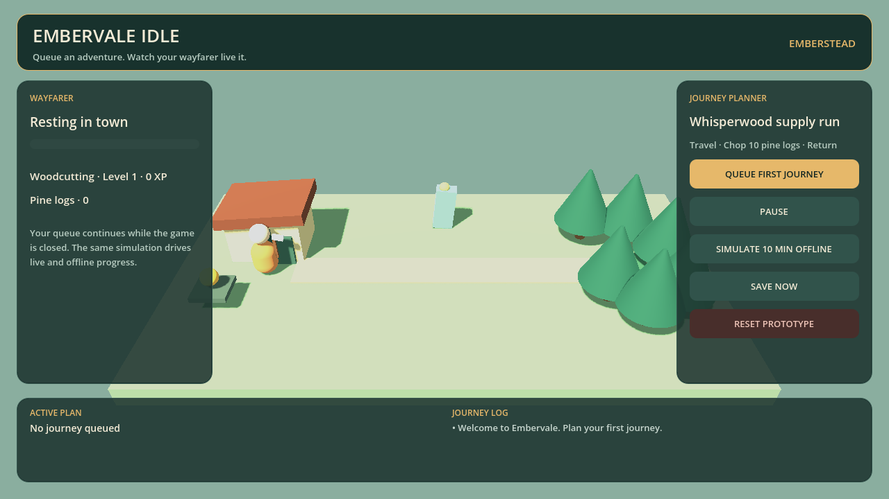

# Embervale Idle

> Queue an adventure. Watch your wayfarer live it.



Embervale Idle is an open-source experiment combining the planning and offline progression of an idle RPG with a compact, visible 3D fantasy world. You prepare journeys, choose activities and safety rules, then watch one persistent hero carry out the plan while the game is open—or simulate it when you return.

## Current status

**Pre-alpha walking-spreadsheet prototype.** The first end-to-end loop is playable:

- Queue a journey from Emberstead to Whisperwood.
- Watch the wayfarer travel through the 3D valley.
- Automatically chop ten pine logs and gain Woodcutting XP.
- Return to town, pause/resume, save locally, or simulate ten offline minutes.
- Reload an unfinished plan and receive a concise return report.

The current geometry is intentionally made from Godot primitives. It proves the simulation, UI, camera, and 3D-state binding before final art production begins.

## Why this exists

RuneScape makes skill progression feel grounded in a place, while Melvor Idle turns similar preparation and progression into something that respects idle time. Embervale Idle explores the missing middle: **what if an idle character still inhabited a world you could see change?**

The project is an original game concept. It does not use RuneScape or Melvor code, names, art, audio, story, or other proprietary assets.

## Run the prototype

1. Install [Godot 4.7.1](https://godotengine.org/download/archive/4.7.1-stable/).
2. Clone this repository.
3. Import `project.godot` in Godot.
4. Press **F6/F5** or click **Run Project**.

Windows command-line example:

```powershell
godot --path .
```

## Run the tests

```powershell
godot --headless --path . --script res://tests/test_simulator.gd
```

The test suite currently verifies:

- exact completion and rewards for the starter plan;
- equivalent results when time is simulated in one large block or many small blocks;
- paused plans do not consume time or grant rewards.

## Design principle

The simulation is authoritative. The 3D character visualizes simulation state; animations, physics, and frame rate never decide rewards. That same deterministic simulator advances both live and offline play.

```text
Content definitions
        |
        v
Game state <-> Action queue <-> Idle simulator
    |                              |
    v                              v
Local save                   Journey events
        \                       /
         +---- UI + 3D view ----+
```

## Repository map

```text
scenes/                 Godot scenes
scripts/                simulation, save, content, and presentation code
tests/                  headless simulation checks
docs/images/            public project screenshots
GAME_PLAN.md            full design and ten-week vertical-slice plan
ROADMAP.md              public milestone tracker
```

## Near-term roadmap

The next milestone expands this proof into a vertical slice:

- resource reserves and safe stop conditions;
- inventory capacity and equipment;
- mining, fishing, cooking, smithing, and hands-off combat;
- restoration goals that visibly repair the forge, bridge, and Waystone;
- a complete first-region guardian encounter.

See [ROADMAP.md](ROADMAP.md) for milestones and [GAME_PLAN.md](GAME_PLAN.md) for the full design brief.

## Contributing

The project is early, so small focused contributions are the most useful: deterministic simulation tests, accessibility improvements, save-safety fixes, and clear UI feedback. Read [CONTRIBUTING.md](CONTRIBUTING.md) before opening a pull request.

## License

Source code and original repository assets are released under the [MIT License](LICENSE).
